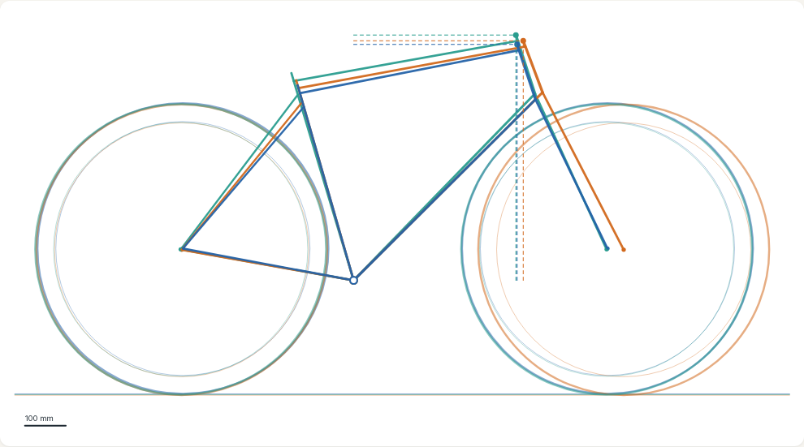

# Gravel geometry explorer: published geometry for 24 current gravel bikes, compared and drawn to scale

An interactive site for comparing gravel bike geometry. Every size of 24 current gravel bikes, typed in from the manufacturers' own charts, checked against itself, and turned into a stack and reach explorer, side-by-side comparisons drawn to scale, a rider overlay, a geometry builder, a handling explainer, and five small studies that borrow methods from epidemiology.

**Live site:** [emmabranch.github.io/gravel-geometry](https://emmabranch.github.io/gravel-geometry/) | **Code:** this repository | **More projects:** [github.com/emmabranch](https://github.com/emmabranch)

## What it does

- Collects published geometry for **24 bikes from 19 brands**, every size, typed in by hand from each manufacturer's chart, with the source page and access date for every bike and the chart text kept in `data/chart-captures/`, plus each build's stock stem, cranks, and seatpost from its spec page.
- **Checks the typing** by recalculating top tube, wheelbase, front centre, and trail from the other numbers on each chart, and flags anything that does not add up.
- **Calculates** trail, mechanical trail, wheel flop, stack-to-reach ratio, front centre, and toe clearance, and **estimates fork offset** where a brand does not publish it (within 2 mm of the published value for 115 of 118 sizes where it is published).
- **Explore:** a stack and reach scatter plot of every size, with filters for category, brand, tyre clearance, and size, and a downloadable table.
- **Compare:** two or three bikes side by side, with each measure placed among all 135 sizes, a plain-language summary of what differs and of each bike on its own, and the frames drawn to scale over each other.
- **Rider:** a stick-figure rider, built from published body proportions and StatCan height data, drawn on every size of a bike with its stock stem, cranks, and seatpost (or your own), with fit numbers for every size (saddle height and setback, bar stack and reach, BB to bar, and saddle to bar) and flags for sizes that look too small or too large. The flags are calibrated against manufacturers' own size charts (86% of too-small and 82% of too-large sizes caught in a leave-one-bike-out check).
- **Fit matcher:** type in where your saddle and handlebar sit now, and see which size of every bike puts you in the same place, with the stem, spacers, and seatpost it would take.
- **Design:** set your own geometry, or start from any bike, and see it drawn with a rider, checked for problems, and matched to the three closest production bikes.
- **Handling:** interactive diagrams of trail, wheelbase, and bottom bracket drop, and what each does to how a bike rides.
- **Epi studies:** measurement agreement (Bland–Altman), growth-chart centiles of stack for reach, whether smaller riders get the same bike, labels against geometry clusters (Cohen's kappa), and geometry over time from archived manufacturer charts.
- **Sharing and export:** every comparison, rider, and design has a shareable link, and drawings save as images or print to PDF.
- Runs entirely in the browser (Quarto with Observable JS), so it needs no server and is hosted on GitHub Pages.

Brand and model names are used as factual labels only. The site does not rank bikes.

## Data and licences

- **Geometry:** each manufacturer's public geometry chart, read on 21 November 2026. Source pages are listed for every bike on the site's [Data and methods](https://emmabranch.github.io/gravel-geometry/methods.html) page and in `data/gravel_geometry.csv`. Figures are factual measurements reproduced for comparison. Manufacturers may change them without notice.
- **Code:** MIT licence (see [`LICENSE`](LICENSE)).

This is an independent project. It is not affiliated with or endorsed by any company named here.

## How to reproduce

1. Install R (4.3 or later), Quarto, and the R packages `readr`, `dplyr`, `tidyr`, `here`, and `quantreg`.
2. The typed-in data are in `data/gravel_geometry.csv`, described in `data/data_dictionary.csv`.
3. Run `R/check_geometry.R` to recheck the data. It changes nothing and prints anything that does not add up.
4. Run `R/derive_measures.R` to write `data/gravel_geometry_derived.csv`, the file the site reads.
5. Run `R/epi_studies.R` to write the result files for the Epi studies page. Older generations of seven bikes, typed from archived manufacturer pages, are in `data/gravel_geometry_history.csv`.
6. Run `quarto render`. The site is written to `docs/`.

The browser-side code is in `js/`: `geometry.js` (frame drawing and the builder's checks), `rider.js` (the rider model and size flags), `draw.js`, `explain.js`, `share.js`, and `export.js`.

## Limitations

- Manufacturers measure some things differently, especially seat tube length, standover, and front centre, and few say which reference tyre their trail and BB height assume.
- Three brands (Canyon, Devinci, and 3T) do not publish fork offset, so their trail uses an estimated offset.
- Race, all-round, and adventure are this project's labels, based on each manufacturer's description, not a standard.
- Drawings join published points with straight lines, so curved tubes and bent forks are simplified.
- Geometry is one part of fit. Stem, spacers, bars, and saddle setup change a rider's position as much as the frame does.
- The rider model is an estimate from average body proportions, not a bike fit, and the size flags are rules of thumb.

## About me

I'm Emma Branch, an epidemiologist and data analyst in British Columbia, and a PhD candidate in Population and Public Health at the University of British Columbia. I've spent about 10 years working with health research data, including registry analytics, REDCap database design, data governance, and performance measurement. I mostly work in R, SAS, and SQL, and build reports and tools with Quarto, Shiny, leaflet, and Power BI. Lately I've been applying the same habits to environmental and ocean data, mostly because I like maps and fish.
