::::: {.hero-full .column-screen}

```{=html}
<div class="hero-bg" aria-hidden="true"></div>
```

:::: {.hero-inner}

[Portfolio project · Quarto · Observable JS · D3]{.eyebrow}

# Gravel bike geometry. [Compared, explained, and test-ridden on paper.]{.accent}

Published geometry for current gravel bikes, every size, typed in from the manufacturers' own charts and checked against itself. More is on the way: drawings to scale, a rider on each bike, and a custom bike builder.

[Explore the bikes](explore.qmd){.btn .btn-accent} [Compare two bikes](compare.qmd){.btn .btn-ghost} [Code on GitHub](https://github.com/emmabranch/gravel-geometry){.btn .btn-ghost}

[Background: all 24 bikes in their middle size, drawn to scale over each other at the bottom bracket, lit up one at a time.]{.hero-note}

::::

```{=html}
<svg class="hero-wave" viewBox="0 0 1440 80" preserveAspectRatio="none" aria-hidden="true"><path d="M0,40 C240,80 480,0 720,30 C960,60 1200,10 1440,40 L1440,80 L0,80 Z"></path></svg>
```

:::::

:::: {.stat-row .lift}
::: {.stat-box}
[24]{.num}

[current gravel bikes from 19 brands]{.lab}
:::
::: {.stat-box}
[135]{.num}

[frame sizes, plus alternative flip chip and fork settings]{.lab}
:::
::: {.stat-box}
[54 to 90 mm]{.num}

[range of trail, from twitchy race bikes to steady tourers]{.lab}
:::
::::

## What this is

A bike's geometry is the set of lengths and angles that decide how it fits and how it handles. Manufacturers publish them in charts that are hard to compare by eye. This site puts them side by side.

- **Every number comes from the manufacturer's own chart**, with the page and the date it was read. Charts change, so check the source before buying anything.
- **The numbers are checked against each other.** Trail, top tube, and wheelbase can each be recalculated from the other measurements, which catches typing slips.
- **No rankings.** Different geometry suits different riders and rides. The point is to see the differences, not to pick a winner.

## Try it: how trail changes

Trail is the distance on the ground between where the steering axis points and where the front tyre actually touches down. More trail feels steadier. Less trail feels quicker. Move the sliders and watch it change.

::: {.calc-card}

```{ojs}
viewof hta = Inputs.range([66, 74], {value: 71, step: 0.5, label: "Head tube angle (°)"})
viewof offset = Inputs.range([40, 60], {value: 50, step: 1, label: "Fork offset (mm)"})
viewof tyre = Inputs.range([35, 55], {value: 45, step: 1, label: "Tyre width (mm)"})
```

```{ojs}
trail = {
  const radius = 622 / 2 + tyre;          // 700c rim plus tyre, assuming tyre height = width
  const a = hta * Math.PI / 180;
  return (radius * Math.cos(a) - offset) / Math.sin(a);
}
md`**Trail: ${trail.toFixed(1)} mm**`
```

:::

For diagrams of trail, wheelbase, and bottom bracket drop, and what each does to how a bike rides, see [How geometry changes handling](handling.qmd).
